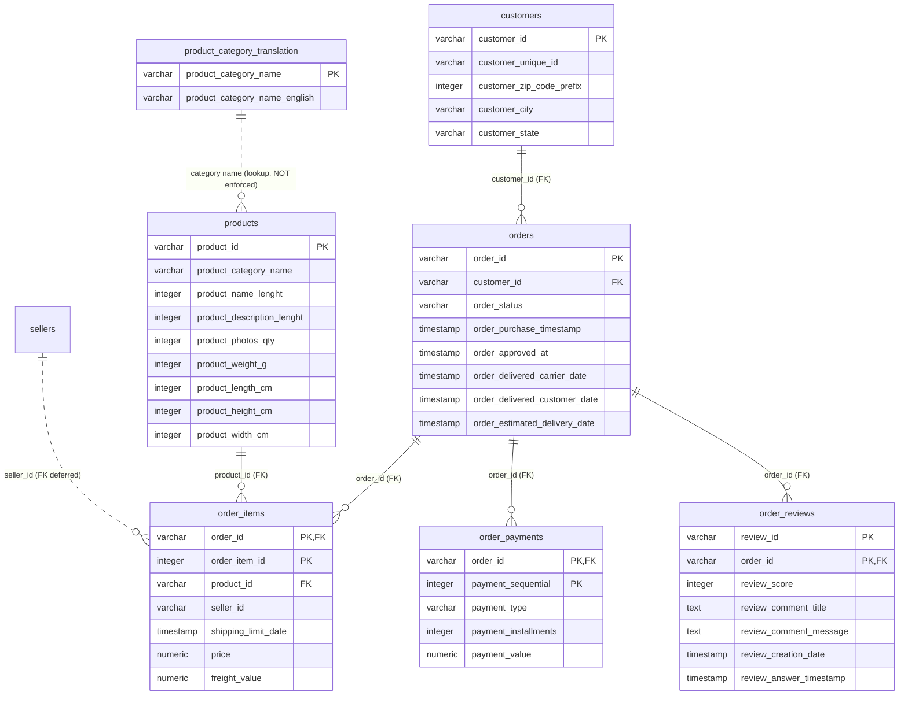

# Database Schema — `olist_copilot`

Relational schema for the Olist Brazilian e-commerce dataset, designed from the
facts in [data_inspection.md](data_inspection.md). DDL: [`db/schema.sql`](../db/schema.sql).

## Scope

Phase 1 imported the **6 tables needed for the first analytical questions**;
Phase 2 added `order_reviews` for the review-score metric:

| Table | Source CSV | Rows | Grain |
|---|---|---:|---|
| `customers` | `olist_customers_dataset.csv` | 99,441 | One order-side customer record |
| `orders` | `olist_orders_dataset.csv` | 99,441 | One order |
| `product_category_translation` | `product_category_name_translation.csv` | 71 | One category (PT → EN lookup) |
| `products` | `olist_products_dataset.csv` | 32,951 | One product |
| `order_items` | `olist_order_items_dataset.csv` | 112,650 | One unit of a product in an order |
| `order_payments` | `olist_order_payments_dataset.csv` | 103,886 | One payment transaction |
| `order_reviews` | `olist_order_reviews_dataset.csv` | 99,224 | One review (added Phase 2) |

**Deferred** (not needed yet): `sellers`, `geolocation`. They are profiled in
the inspection report and added when a later phase needs them.

## Entity-relationship diagram

## Keys and relationships

| Constraint | Columns | Verified |
|---|---|---|
| PK `customers` | `customer_id` | unique in source |
| PK `orders` | `order_id` | unique in source |
| PK `order_items` | `(order_id, order_item_id)` | unique in source |
| PK `order_payments` | `(order_id, payment_sequential)` | unique in source |
| PK `products` | `product_id` | unique in source |
| PK `product_category_translation` | `product_category_name` | unique in source |
| PK `order_reviews` | `(review_id, order_id)` | unique in source (review_id alone is NOT) |
| FK `orders → customers` | `customer_id` | 0 orphans |
| FK `order_items → orders` | `order_id` | 0 orphans |
| FK `order_items → products` | `product_id` | 0 orphans |
| FK `order_payments → orders` | `order_id` | 0 orphans |
| FK `order_reviews → orders` | `order_id` | 0 orphans |

## Design decisions (and why)

1. **Column names match the source CSVs exactly**, including the source's
   `product_name_lenght` / `product_description_lenght` misspelling. This keeps
   COPY loading lossless and traceable; the quirk is documented for the LLM
   context in Phase 2 instead of being silently "fixed".
2. **No FK on `products.product_category_name`.** The translation file covers
   only 71 of the 73 categories used by products: `pc_gamer` (3 products) and
   `portateis_cozinha_e_preparadores_de_alimentos` (10 products) are missing.
   An enforced FK would reject 13 valid products. The translation table is a
   lookup — always `LEFT JOIN` it. 610 products have a NULL category.
3. **No FK on `order_items.seller_id` yet.** The sellers table is deferred;
   all 112,650 seller_id values were verified against the source sellers CSV
   (0 orphans), so the FK can be added when sellers is imported.
4. **`customer_id` vs `customer_unique_id`.** `customer_id` is unique per row
   and is what orders reference; the same person can appear under several
   `customer_id` values (96,096 distinct `customer_unique_id` across 99,441
   rows). "Number of customers" must be defined against `customer_unique_id`
   in the business glossary (Phase 2).
5. **Zip code prefixes are `integer`.** The source stores them as numbers, so
   leading zeros are already lost (e.g. `1037` means `01037`). Kept as-is to
   match the source; do not silently zero-pad.
6. **Money is `numeric(10,2)`**, never float: `order_items.price`,
   `order_items.freight_value`, `order_payments.payment_value`.
7. **Timestamps are `timestamp` (no time zone)** — the source has no zone
   information. `order_approved_at` (160 NULLs),
   `order_delivered_carrier_date` (1,783), `order_delivered_customer_date`
   (2,965) are nullable because those lifecycle events did not occur for
   every order.
8. **Product attribute columns are nullable `integer`** (610 NULLs for
   name/description length and photos; 2 NULLs for weight/dimensions). The
   CSV stores them as plain integers; pandas showed floats only because of
   the NULLs.
9. **`order_status` has 8 observed values**: approved, canceled, created,
   delivered, invoiced, processing, shipped, unavailable. Semantics (e.g.
   what counts as a cancellation) are defined in the Phase 2 glossary.
10. **One order has no payment row** (99,440 distinct orders in payments vs
    99,441 orders). Payment-based metrics must state how they treat it.
11. **`order_items` grain is one row per unit**: `order_item_id` enumerates
    units of the same product in one order (max 21). "Quantity" is a count of
    rows, not a column.
12. **Reviews key strategy (resolved in Phase 2).** `review_id` is NOT unique
    in the source (98,410 distinct of 99,224 rows; 1,603 rows share a
    `review_id` across different orders). `(review_id, order_id)` was verified
    unique and is the primary key. 547 orders have more than one review, so
    review metrics average over review rows, not orders.
13. **Geolocation caveat for later**: no primary key, 261,831 duplicate rows
    of 1,000,163 — it is a lookup, not an entity.

## Indexes

Beyond PKs: `orders(customer_id)`, `orders(order_status)`,
`orders(order_purchase_timestamp)`, `order_items(product_id)`,
`order_items(seller_id)`, `products(product_category_name)`,
`customers(customer_unique_id)`, `order_reviews(order_id)` — covering the
joins, filters and groupings of the first analytical questions.